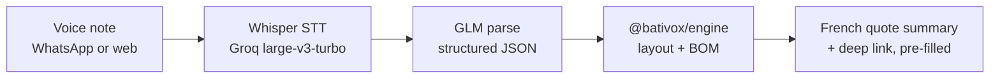

# Bativox

Tile layout calculation and voice quoting for French tilers. Describe a job, get a quote.

Live: [bativox.pages.dev](https://bativox.pages.dev)


## The product

A tiler measures the room, and the app answers the questions that actually cost money: how many tiles, where do the cuts fall, how much adhesive and grout, how much waste. Quotes export as PDF.

## The vocal pipeline

The feature tilers actually asked for: no typing on a dusty job site. They send a WhatsApp voice note in plain French and get the quote back.



Input like *"j'ai une chambre de 4 mètres 20 sur 3 mètres, carreaux gris 60 par 60, joints de 3 millimètres, pose en diagonale, et une crédence de 2 mètres sur 60"* comes back as a full calculation in about three seconds: 33 tiles, 10 boxes, 19 kg adhesive, 4 kg grout, diagonal layout detected, backsplash calculated separately, deep link to the app with the job pre-filled.

Two design choices make this reliable:

- **Regex fallback parser.** French measurement phrasing ("4m20", "4,20 mètres", "420 par 310") is handled deterministically before the LLM sees it. Simple phrases never touch a model.
- **Cost structure.** Groq Whisper large-v3-turbo plus a single GLM call: about €0.002 per voice note. The unit economics work at artisan prices.

## The engine

`@bativox/engine` is pure TypeScript, zero dependencies, no side effects: same input, same layout, runnable in a Worker or Node.

What it actually computes:

- **Centered tiling**: symmetric edge cuts on every axis, with the exact coverage convention (n tiles + (n-1) joints, no joint against the wall). A reference case was verified by hand: 4200 x 3100 mm room, 600 x 600 tiles, 3 mm joint, 591 mm edge cuts.
- **Cut lists grouped by size** for serial cutting, with detection of slivers under 50 mm, the cuts that break tiles in practice.
- **BOM rules from the field**: 1.5 kg/m2 adhesive for single bedding, 3 kg/m2 above 600 mm tiles (double bedding), grout adjusted per joint width, skirting counted.
- **Patterns**: straight, running bond with offset ratio, 45 degree diagonal. The diagonal path is honest about what it does not measure (real edge cut lengths), instead of displaying fake waste numbers.

## Architecture

```mermaid
graph TB
    subgraph Edge [Cloudflare Pages Functions]
        API[API: vocal, webhook, waitlist]
    end
    subgraph App [PWA Next.js 15, static export]
        WIZ[Wizard + PDF quotes]
    end
    subgraph Packages
        ENG[@bativox/engine<br/>pure TS, 0 deps]
        WA[whatsapp-worker<br/>Meta Cloud API]
    end
    API --> ENG
    WIZ --> ENG
    WA --> ENG
```

- **Edge**: Cloudflare Pages Functions on the same domain (no separate worker, no DNS gymnastics). Meta webhook with token verification and signature checking, CORS locked down.
- **App**: Next.js 15 static export PWA. The wizard reads a prefill URL parameter (base64url JSON) so a voice quote deep-links straight into a filled job.
- **Tests**: engine layout tests including the hand-verified reference case, French parser variation tests, prefill round-trip tests.

## Status

In production at bativox.pages.dev, used for real quoting. WhatsApp integration is wired end to end (webhook verified, signature checked); the Meta Business app activation is the last switch.

## Stack

TypeScript, Next.js 15, Cloudflare Pages + Pages Functions, Groq Whisper, GLM, jsPDF. vitest across engine, parser and prefill.

---

*Showcase repo: architecture and pipeline. The engine source stays private.*
